# TrailOps

**Offline-first equipment operations for trek base camps.**

TrailOps helps camp teams issue, return, inspect, repair and hand over trek equipment — even without a
network signal. Field staff work in an Android app that saves every action on the device and syncs when
a connection returns; supervisors manage inventory, approvals, handovers, forms and audit history in a web
console.

> **Independent applicant concept.** TrailOps is not an Indiahikes product and is not connected to any
> Indiahikes system. All people and records in the sample data are fictional.

---

## Table of contents

- [Features](#features)
- [Screenshots](#screenshots)
- [Tech stack](#tech-stack)
- [Architecture](#architecture)
- [Project structure](#project-structure)
- [Getting started](#getting-started)
- [Sample accounts](#sample-accounts)
- [Configuration](#configuration)
- [Useful commands](#useful-commands)
- [Known limitations](#known-limitations)
- [Acknowledgements](#acknowledgements)

## Features

### Mobile app (field staff)

- **Works offline** — issue gear, record returns and receive handovers with no signal; work is saved on
  the device and synced automatically when the connection returns.
- **QR scanning** with manual tag entry as a fallback.
- **Issue gear** to trekkers from the batch roster, with due dates and a physical-handover confirmation.
- **Return inspections** driven by versioned dynamic forms, with photo evidence captured on the device.
- **Tag-by-tag handovers** between camps, including missing and unexpected items.
- **Sync centre** showing what is saved on the phone, what the server confirmed and what needs review.
- **Conflict resolution** when two people issue the same item while offline.
- Secure sign-in through the system browser, with separate local data per account.

### Web console (supervisors and administrators)

- Equipment inventory with filters, item history and printable QR labels.
- Repair approvals through to release, with verified photo evidence.
- Handover dispatch, receipt and discrepancy reconciliation.
- Visual form editor with a live mobile preview and versioned publishing.
- Searchable audit trail with server and device timestamps.
- User and camp access management.

## Screenshots

### Mobile app

| Camp home | Equipment | Issue gear | Return inspection |
| --- | --- | --- | --- |
| 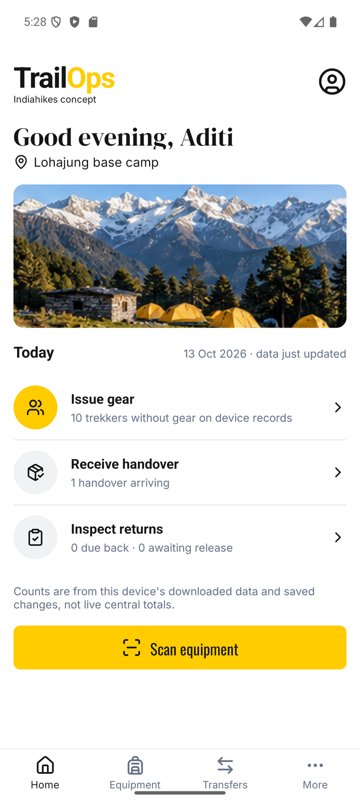 | 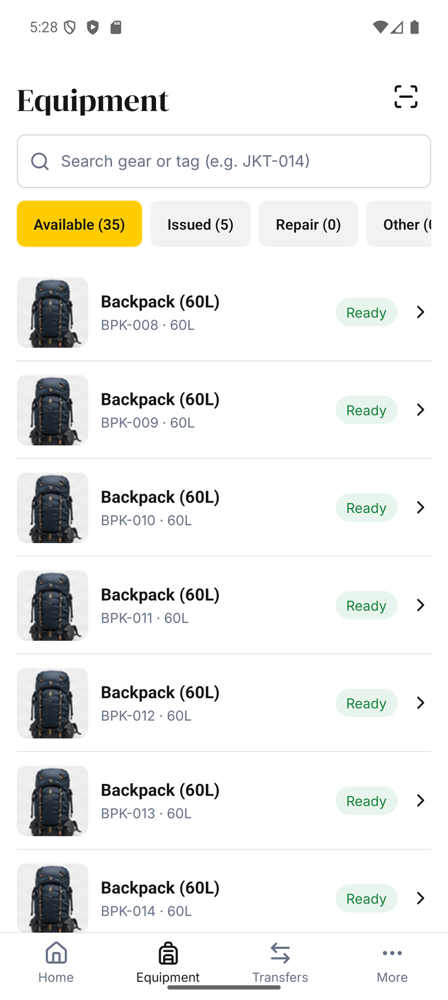 | 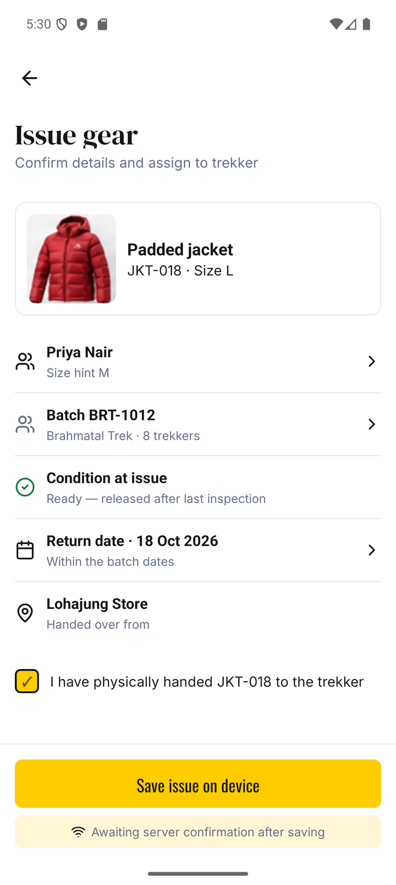 | 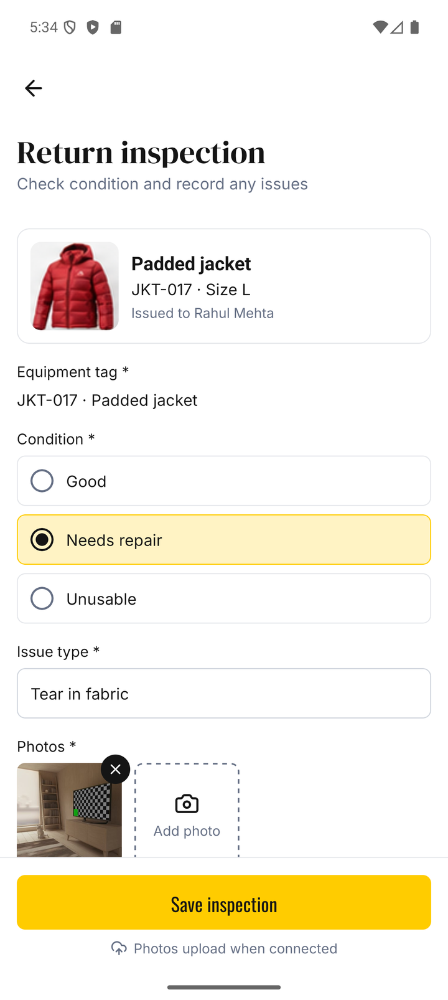 |

| Receive handover | Sync centre | Allocation conflict | Repair review |
| --- | --- | --- | --- |
| 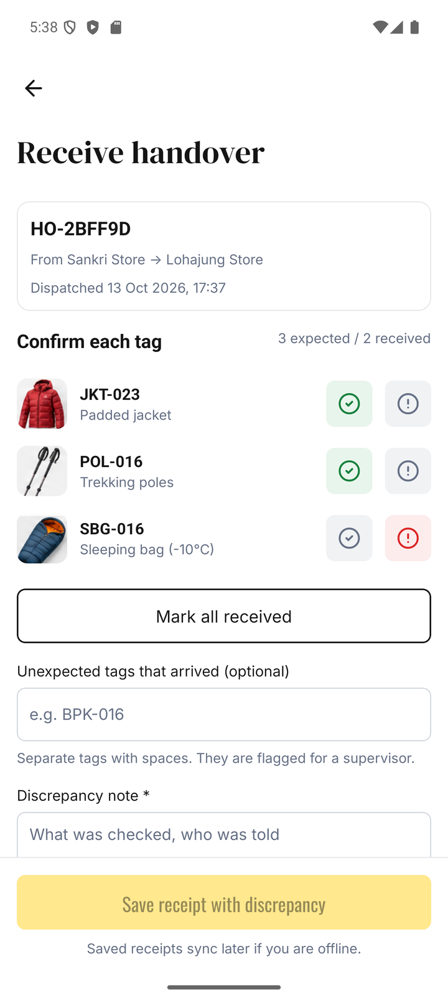 | 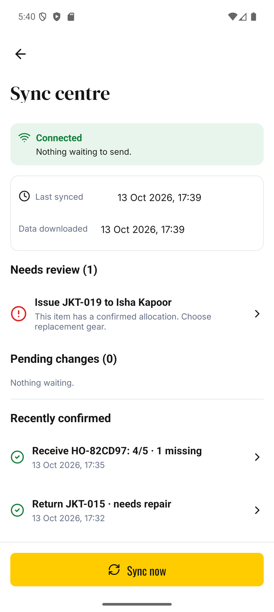 | 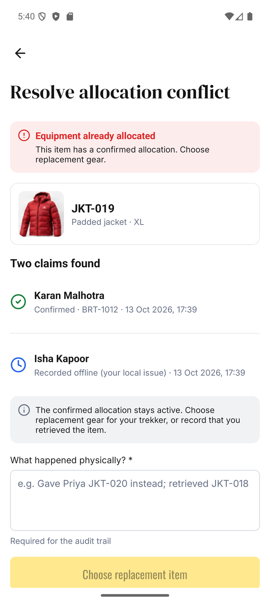 | 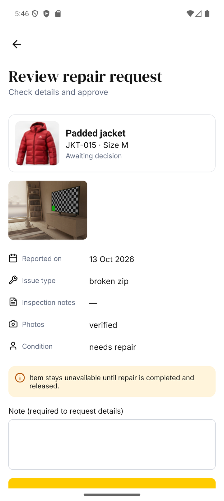 |

### Web console

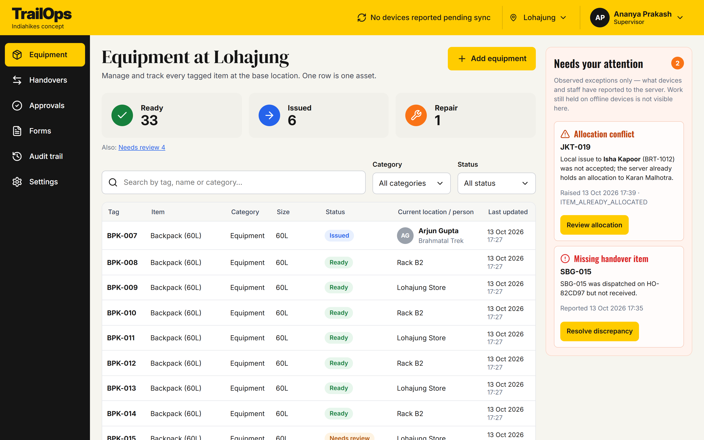

| Repair approvals | Form editor |
| --- | --- |
| 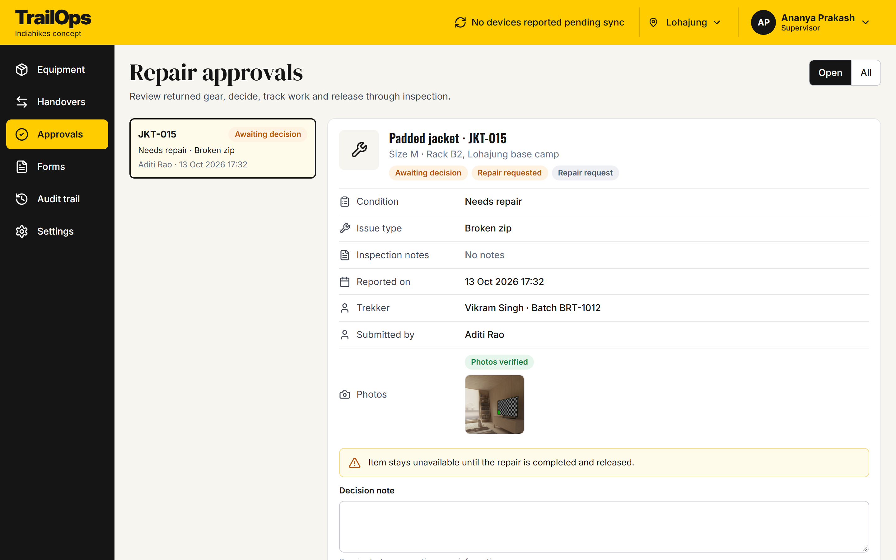 | 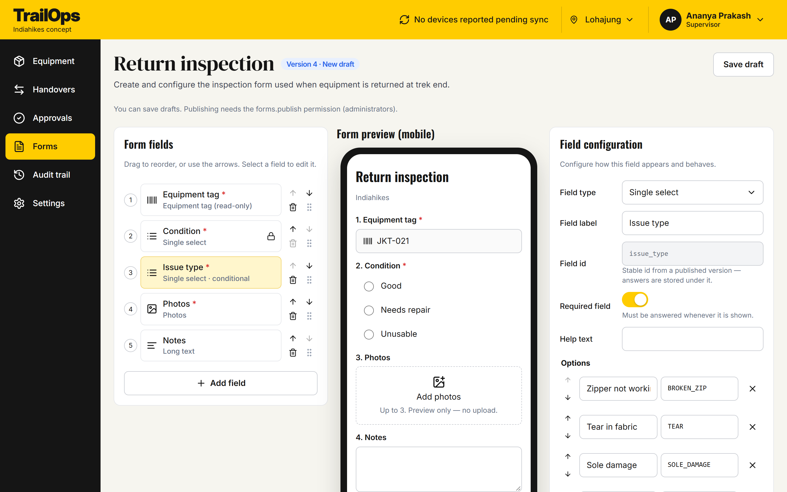 |

All screenshots are in the [`screenshots`](screenshots) folder.

## Tech stack

| Layer | Technology |
| --- | --- |
| Mobile | React Native CLI 0.81, TypeScript, WatermelonDB (SQLite), React Navigation, VisionCamera |
| Web console | React 18, TypeScript, Vite, TanStack Query, React Router, oidc-client-ts |
| API | Python 3.13, FastAPI, Pydantic v2, SQLAlchemy 2 (async), Alembic |
| Database | PostgreSQL 17 |
| Identity | Keycloak 26 (OpenID Connect, Authorization Code + PKCE) |
| Tooling | uv, pnpm, npm, Docker Compose, GitHub Actions |

## Architecture

```
 Android app ──┐                         ┌── PostgreSQL
 (offline-first)│   commands + sync      │
               ├──────────────────────▶  FastAPI  ──┤
 Web console ──┘   (online)              │           └── evidence storage
                                         │
                    Keycloak (OIDC) ◀────┘
```

- **Commands, not row edits.** Every user action becomes an immutable command (for example
  `ISSUE_GEAR`, `SUBMIT_RETURN`, `DISPATCH_TRANSFER`) with its own ID. The server applies each command
  in a single transaction and stores the result, so retries are safe and never duplicate work.
- **Durable local queue.** The app writes the command to its local database before showing success,
  and sends it when online. Unconfirmed actions are shown as *provisional* — never as confirmed.
- **Ordered, scoped sync.** Devices download only the camps they are assigned to and pull changes in
  commit order. Access changes trigger a fresh download so revoked data is removed from the phone.
- **Evidence handled separately.** Photos are uploaded on their own and verified (size, checksum, file
  type, metadata stripped) before they can unlock any workflow.
- **Conflicts are first-class.** If two devices issue the same item, the first confirmed allocation
  wins, the other claim is kept for a person to reconcile, and the item stays blocked until then.

The full design is in [`TrailOps-Technical-Documentation.md`](TrailOps-Technical-Documentation.md).

## Project structure

```
.
├── apps/
│   ├── mobile/            React Native CLI app (Android)
│   └── web/               Supervisor web console
├── packages/
│   └── contracts/         Shared TypeScript types, form engine and QR label codec
├── services/
│   └── api/               FastAPI service, Alembic migrations and job worker
├── infra/                 Docker Compose, PostgreSQL init and Keycloak realm
└── docs/                  Compatibility notes and project records
```

## Getting started

### Prerequisites

- Docker
- Python 3.13 and [uv](https://docs.astral.sh/uv/)
- Node.js 24 and pnpm 11
- For the mobile app: Android SDK, JDK 17 and an emulator or device

### 1. Start PostgreSQL and Keycloak

```bash
docker compose -f infra/compose.yml up -d postgres keycloak
```

Keycloak is available at <http://localhost:8180> with the `trailops` realm imported.

### 2. Set up and run the API

```bash
uv --directory services/api sync
```

```bash
uv --directory services/api run alembic upgrade head
```

Load the sample data (two camps, 50 tagged items, 20 trekkers, four users):

```bash
uv --directory services/api run python -m app.demo.seed --reset
```

```bash
uv --directory services/api run uvicorn app.main:app --port 8000 --host 0.0.0.0
```

The API runs at <http://localhost:8000> (health check: `/health/ready`).

### 3. Run the web console

```bash
pnpm install --frozen-lockfile
```

```bash
pnpm --filter web dev
```

Open <http://localhost:5173> and sign in with one of the [sample accounts](#sample-accounts).

### 4. Run the mobile app (Android)

```bash
npm --prefix apps/mobile ci
```

```bash
npm --prefix apps/mobile run start
```

In a second terminal, forward the local services to the emulator or device:

```bash
adb reverse tcp:8081 tcp:8081 && adb reverse tcp:8000 tcp:8000 && adb reverse tcp:8180 tcp:8180
```

```bash
npm --prefix apps/mobile run android
```

To build a standalone APK:

```bash
cd apps/mobile/android && ./gradlew assembleRelease
```

The APK is written to `apps/mobile/android/app/build/outputs/apk/release/`.

## Sample accounts

All sample users share the password `trailops-demo`.

| Username | Role | Camps |
| --- | --- | --- |
| `aditi` | Camp operator | Lohajung |
| `ramesh` | Trek leader | Lohajung |
| `ananya` | Supervisor | Lohajung, Sankri |
| `kabir` | Administrator | All camps |

## Configuration

### API (`services/api/.env`)

Copy `services/api/.env.example` to `services/api/.env` and adjust as needed.

| Variable | Description |
| --- | --- |
| `DATABASE_URL` | PostgreSQL connection string |
| `OIDC_ISSUER` | Keycloak realm URL; must match the `iss` claim in access tokens |
| `OIDC_AUDIENCE` | Expected token audience (`trailops-api`) |
| `STORAGE_BACKEND` | `local` (signed upload slots served by the API) or `s3` |
| `WEB_ORIGINS` | Allowed CORS origins for the console |
| `OFFLINE_ALLOWANCE_HOURS` | How long a signed-in device may work offline (default 72) |
| `SIGNING_SECRET` | Secret used to sign sync cursors and upload slots — change it outside local use |

### Web console (`apps/web/.env.local`)

| Variable | Default |
| --- | --- |
| `VITE_API_BASE` | `http://localhost:8000` |
| `VITE_OIDC_AUTHORITY` | `http://localhost:8180/realms/trailops` |
| `VITE_OIDC_CLIENT_ID` | `trailops-web` |

### Mobile app

Service addresses are set in `apps/mobile/src/app/config.ts`. Plain HTTP is only allowed for
`localhost` and the Android emulator host; any other address must use HTTPS.

## Useful commands

| Task | Command |
| --- | --- |
| Run the job worker | `uv --directory services/api run python -m app.jobs.worker --scheduler` |
| Create a migration | `uv --directory services/api run alembic revision --autogenerate -m "message"` |
| Lint the API | `uv --directory services/api run ruff check app tests` |
| Build the console | `pnpm --filter web build` |
| Type-check the console | `pnpm --filter web typecheck` |
| Type-check the mobile app | `npm --prefix apps/mobile run typecheck` |
| Regenerate the OpenAPI contract | `pnpm contracts` |

## Known limitations

- Android only — the iOS app has not been built or tested.
- The mobile app uses React Native's legacy architecture for WatermelonDB compatibility.
- Evidence is stored by the API locally by default; the S3 storage option is untested.
- Integrations with external booking or rental systems are not included.
- Offline allowance, grace periods and approval rules are proposals that need stakeholder review.

## Acknowledgements

- Icons: [Lucide](https://lucide.dev) (ISC licence).
- Fonts: Inter, Oswald and DM Serif Display (SIL Open Font License).
