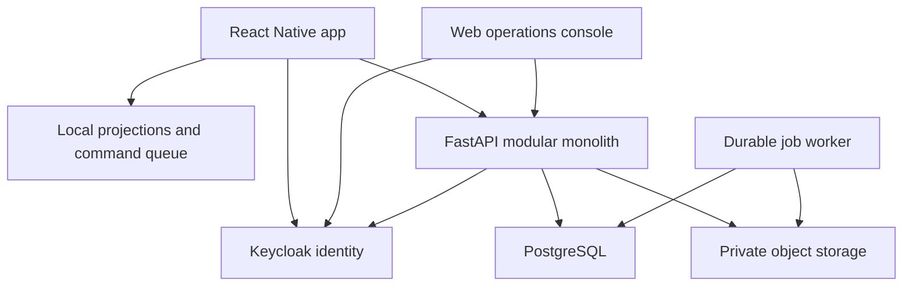

# TrailOps — Technical Build Specification

Version 1.0 · 10 October 2026 · Independent applicant POC for Indiahikes

## 1. Purpose, scope and status

Build an internal equipment-operations product that remains useful without connectivity. A mobile user downloads an assigned camp's data, records gear issues, returns, inspections and handovers, and reconciles those actions with a Python backend. A web console manages inventory, repairs, exceptions and form definitions.

This is a proposed specification, not Indiahikes' internal architecture or approved operating procedure. Operational rules, camp names, approval thresholds and integrations must be validated with their team. No access to their AppSheet application, production schemas, identity provider or APIs is assumed. The current deliverables are designs, an asset pack and this specification; the application and the tests below have not been implemented or executed.

The specification covers the 15 designed views: splash, sign-in, camp home, equipment list, item detail, QR scanning, issue gear, return inspection, repair approval, dispatch handover, receive handover, sync centre, allocation conflict, desktop equipment console and desktop form editor. Additional support views are explicitly proposed where needed for a complete workflow.

### Scope boundaries

| POC must demonstrate | Production extension | Outside this POC |
| --- | --- | --- |
| Offline issue/return and local persistence | Managed-device encryption and remote lifecycle policies | Trek booking and payment gateway |
| Single-item rental allocation | Reservations, billing and refund integration | Automated medical decisions |
| Tagged-asset handovers | Bulk consumables and procurement | GPS navigation and live rescue dispatch |
| One versioned inspection form | A larger catalogue of forms | AI agents and chatbots |
| Repair approval and release | Spare parts and vendor repair services | Replacing their existing production systems |
| Two-device conflict demonstration | Larger field pilot and data migration | Full general-purpose workflow designer |

Use one organization, two fictional locations, 20 fictional trekkers, 50 tagged assets and four demo users. Do not use real trekker personal data in the demo.

## 2. Principal architectural decisions

1. Use a modular monolith in FastAPI rather than separate services for each module.
2. Use React Native CLI and TypeScript for mobile; WatermelonDB stores durable local data. Use React + TypeScript + Vite for the online supervisor console.
3. Use PostgreSQL as the central authority, async SQLAlchemy for persistence, and Alembic for migrations.
4. Use Keycloak OIDC for identity. Backend permissions additionally require current organization and camp membership from PostgreSQL.
5. Synchronize business commands, not unrestricted row changes. Local clients cannot directly set an asset's authoritative status or approve a repair by editing a field.
6. Keep confirmed server projections separate from pending local actions. A pending issue is provisional, even if the physical item was handed over.
7. Use a custom command-and-projection sync adapter. Do not simultaneously use WatermelonDB's standard `synchronize()` to write the same domain records.
8. Make photos independent uploads, associated by durable attachment IDs. A form can be received before its evidence, but a workflow that requires evidence remains blocked.
9. Prefer explicit domain state machines over BPMN for the POC. Dynamic forms do not imply dynamic executable workflows.
10. Treat all mobile-originated values, device clocks and cached permissions as untrusted at the server boundary.

WatermelonDB supplies local storage and sync primitives; it is not a hosted backend [R1]. The command adapter in this document is a TrailOps design choice, not the standard WatermelonDB wire protocol.

### Component relationships



### Stack and compatibility gate

| Layer | Proposed choice | Selection criteria |
| --- | --- | --- |
| Mobile | React Native CLI, TypeScript | Android first; iOS support verified separately |
| Navigation | React Navigation | Typed routes, authentication and camp scopes |
| Local data | WatermelonDB / SQLite | Native build, migrations and restart durability |
| Ephemeral UI state | Legend State or Zustand; choose one | Do not duplicate persistent records in state stores |
| Camera | Native camera/QR package | Verify barcode support and architecture compatibility in a spike |
| Credentials | OS keychain/keystore wrapper | No tokens in plain AsyncStorage |
| Backend | Python 3.13, FastAPI, Pydantic v2 | Async request handling and explicit DTOs |
| Persistence | SQLAlchemy 2 async, asyncpg | One session per request/command transaction [R4] |
| Identity | Keycloak public mobile client + web client | Authorization Code with PKCE |
| Storage | S3-compatible; MinIO for local demo | Private objects and short-lived upload URLs |
| Background work | PostgreSQL job table + dedicated worker | Durable jobs; single scheduler for timed jobs |
| Web | React, TypeScript, Vite | Online-first operations console |
| Delivery | uv, pnpm, Docker Compose, GitHub Actions | Committed lockfiles and reproducible builds |

Do not interpret these as verified exact dependency versions. At project initialization, pin a compatible stable React Native release and native dependencies, run Android/iOS builds, and commit `pnpm-lock.yaml` and `uv.lock`. Record the tested toolchain in `docs/compatibility.md`. The QR package, WatermelonDB adapter, filesystem and secure-store libraries must pass this compatibility gate before feature development.

## 3. Repository structure and boundaries

```text
apps/mobile/src/
  app/                 navigation, startup, dependency composition
  features/            auth, camp, equipment, issues, inspections,
                       repairs, transfers, forms, sync, settings
  database/            models, schema, migrations, repositories
  sync/                coordinator, command queue, projection adapter
  native/              camera, credentials, file storage adapters
  ui/                  tokens, shared controls, status components
apps/web/src/
  features/            equipment, approvals, forms, audit, access
  api/                 generated client and error handling
packages/contracts/    generated TypeScript types and form definitions
services/api/app/
  main.py              app creation and lifespan
  core/                settings, auth, errors, logging, database
  modules/             each module: routes, schemas, service, repository
  jobs/                durable worker handlers
services/api/alembic/   reviewed migrations
services/api/tests/     unit, integration, contract, concurrency
infra/                 compose, Keycloak realm export, deployment notes
docs/                  architecture, decisions, runbooks, demo script
assets/                selected reusable items from assets.zip
```

Routes authenticate, parse DTOs and call services. Services enforce permissions, business transitions and transactions. Repositories perform scoped queries. Services never trust a client-supplied actor ID. Shared code includes transaction helpers, error envelopes and command processing; it must not become an unstructured business-logic folder.

Generate TypeScript types from FastAPI's OpenAPI document and check regeneration in CI. Form-schema contracts have an independent version. Do not share ORM models directly with the mobile app.

## 4. Identity, roles and camp authorization

### Permission matrix

All permissions below require membership of the same organization. Camp scope applies unless explicitly granted organization-wide access.

| Action | Camp operator | Trek leader | Supervisor | Administrator |
| --- | --- | --- | --- | --- |
| View assigned equipment and batch roster | Yes | Yes | Yes | Yes |
| Issue and return gear | Yes | Assigned batches only | Yes | Explicit permission |
| Record inspection | Yes | Assigned assets/batches | Yes | Explicit permission |
| Dispatch/receive transfer | Relevant camp | No by default | Yes | Explicit permission |
| Approve repair / release gear | No | No | Yes | Explicit permission |
| Resolve allocation conflict | Limited local correction | Limited local correction | Yes | Yes |
| Publish forms | No | No | Optional permission | Yes |
| Change membership | No | No | No by default | Yes |
| Read organization-wide audit | No | No | Scoped | Yes |

Represent permissions as strings such as `equipment.read`, `issue.create`, `inspection.submit`, `transfer.dispatch`, `transfer.receive`, `repair.approve`, `repair.release`, `forms.publish`, `audit.read`, `access.manage`. Keep Keycloak roles coarse. Resolve current camp memberships and fine-grained grants on the server. Hiding a button is only a UI convenience.

### Sign-in implementation

1. Mobile opens the system browser for Authorization Code + PKCE; no embedded password collection.
2. Validate state, nonce where applicable and redirect URI. Mobile is a public client with no embedded client secret.
3. Persist refresh credentials in secure OS storage. Use access tokens for API calls.
4. API validates JWT signature against cached issuer JWKS, allowed algorithm, issuer, configured audience, expiry and applicable claims. Configure Keycloak audience mapping for the API. An ID token is not an API access token.
5. Map `sub` to an application user. Fetch organization/camp memberships from the app DB. Deny disabled users and devices.
6. `GET /v1/me` returns user profile, permissions, camp memberships and scope epoch. `POST /v1/devices` registers a device installation.

Keycloak's published OIDC endpoints provide identity-provider integration [R3]. FastAPI security dependencies can expose permissions in OpenAPI, but TrailOps must still implement actual JWT validation and business authorization [R2].

### Offline access policy

Proposed POC policy: an already signed-in person can reopen downloaded data and record low-risk field commands for up to 72 hours after the last successful online policy verification. First-time sign-in requires connectivity. Offline repair approvals, membership edits and form publication are disabled. The 72-hour value is an assumption requiring stakeholder approval, not a Keycloak feature or an Indiahikes policy.

Cached identity authorizes local capture only. On reconnect, the server rechecks current permissions before accepting new commands. A revoked user may still possess cached data until the device reconnects; immediate remote revocation cannot be guaranteed offline. If the offline allowance expires, lock protected data while preserving pending work. Provide a supervised recovery path; do not silently discard it.

Logout and camp/account switching require queue handling. Default: block destructive local cleanup until pending commands and attachments are synced, or offer an explicit encrypted export/recovery workflow. Never mix one user's queue with another user's session. Use separate per-account databases or enforce account partitioning throughout.

## 5. Common domain conventions

- Server entities and operation IDs are UUIDs. Human tags like `JKT-014` are display identifiers, not authorization keys.
- Every mutable aggregate has `organization_id`, `version bigint`, `created_at`, `updated_at`, and optional `deleted_at`. Use `timestamptz` for instants.
- Dates such as rental due date use ISO calendar dates, interpreted in the assigned camp's IANA timezone. Server ordering does not depend on device time.
- Each equipment item is individually tagged in POC scope. Two poles sold/rented as one pair are one asset with unit `pair`; do not interpret the pair as two allocations.
- Client proposals, confirmed business status and sync state are separate fields and concepts.
- Never hard-delete operational history from normal UI. Correct mistakes through audited reversal commands.
- Lists are cursor-paginated, default 50 and maximum 200. Search and filters are scoped before pagination.
- Required foreign keys and unique constraints include organization boundaries. Use composite scoped foreign keys or equivalent enforcement to prevent cross-organization references.
- Opaque IDs do not replace authorization. Check every linked asset, location, batch, attachment and actor.
- Asset photos in the UI pack are decorative. Production IDs and QR labels must be generated from actual stored assets.

## 6. PostgreSQL data model

### Core tables

| Table | Important columns | Constraints and indexes |
| --- | --- | --- |
| organizations | id, name | Unique ID |
| users | id, keycloak_subject, display_name, enabled | Unique identity subject |
| memberships | organization_id, user_id, role, enabled | Unique org/user/role as required |
| camp_memberships | org_id, user_id, camp_id, permissions, access_epoch | Scoped membership index |
| camps | id, org_id, name, timezone, active | Scoped name/code uniqueness |
| locations | id, org_id, camp_id, label, type | Camp plus rack/store lookup |
| devices | id, org_id, user_id, platform, installation_id, enabled, last_seen_at | Unique installation/account mapping |
| trek_batches | id, org_id, code, camp_id, start_date, end_date, external_id | Unique scoped batch code |
| trekkers | id, org_id, display_name, external_id | Minimize stored personal data |
| batch_members | org_id, batch_id, trekker_id | Unique scoped batch/trekker |
| equipment_categories | id, org_id, code, name, unit, inspect_on_return | Unique scoped code |
| equipment_items | id, org_id, tag, category_id, size, status, location_id, version | Unique org/tag; org/location/status/category indexes |
| allocations | id, org_id, item_id, trekker_id, batch_id, issued_by, issued_at, due_date, state, closed_at | One ACTIVE allocation per item |
| inspections | id, org_id, item_id, allocation_id, form_version_id, answers jsonb, condition, evidence_state, submitted_by | Item/time and allocation indexes |
| repairs | id, org_id, item_id, inspection_id, state, approved_by, completed_by, release_inspection_id, version | At most one open repair per item |
| transfers | id, org_id, from_location_id, to_location_id, state, dispatched_by, received_by, version | Origin/destination/state indexes |
| transfer_lines | id, org_id, transfer_id, item_id, receipt_state, discrepancy_reason | Unique transfer/item |
| custody_claims | id, org_id, item_id, source_type, source_id, observed_location_id, state | Open claims keep unresolved assets blocked |
| form_definitions | id, org_id, key, title, active_version_id | Unique org/key |
| form_versions | id, org_id, definition_id, number, status, schema jsonb, schema_hash, published_at | Unique definition/number; published immutable |
| attachments | id, org_id, owner_user_id, inspection_id, content_hash, object_key, mime, bytes, state | Unique object key; state/time index |
| operations | id, org_id, actor_id, device_id, payload_hash, type, state, result jsonb, received_at | Unique org/operation ID |
| conflicts | id, org_id, operation_id, item_id, code, state, resolution_operation_id | Unique operation/conflict type |
| audit_events | id, org_id, aggregate_type, aggregate_id, actor_id, operation_id, event_type, before jsonb, after jsonb, recorded_at, client_recorded_at | Org/aggregate/time and operation indexes |
| change_log | org_id, sequence, entity_type, entity_id, version, before_scope jsonb, after_scope jsonb, deleted, payload jsonb | Primary key org/sequence |
| sync_sequences | org_id, last_sequence | One row per org; transactional commit-order gate |
| jobs | id, org_id, type, payload jsonb, state, attempts, available_at, lease_until, unique_key | Unique dedupe key; ready/available index |

All table references in this specification use `org_id` and `organization_id` interchangeably in prose; choose one actual column naming convention before writing migrations. JSONB answers supplement relational business columns; they do not replace allocation, custody or repair state constraints.

### Essential invariant examples

```sql
CREATE UNIQUE INDEX uq_active_allocation
ON allocations (org_id, item_id)
WHERE state = 'ACTIVE';

CREATE UNIQUE INDEX uq_open_repair
ON repairs (org_id, item_id)
WHERE state IN ('REQUESTED', 'APPROVED', 'IN_PROGRESS', 'AWAITING_RELEASE');

CREATE INDEX ix_equipment_camp_status
ON equipment_items (org_id, location_id, status)
WHERE deleted_at IS NULL;
```

These use PostgreSQL partial indexes [R6]. Transfer exclusivity also requires item-row locking and status checks: a partial index on allocations alone cannot prevent a concurrent transfer. Cross-table invariants live in a common equipment service and are exercised by concurrency tests.

Each domain write transaction: lock the organization sequence row first, then affected item/aggregate rows in sorted UUID order, validate expected versions and current permissions, mutate domain rows, append audit/change events, persist the operation result, increment sequence and commit. For the POC this organization-wide write gate is deliberately simple and serializes mutations; measure its contention before expanding scale. Do not use an ordinary independently allocated sequence as a guarantee of commit ordering.

### Data lifecycle

Confirm retention periods with the organization. For POC proposals: maintain sync changes for 90 days and operation dedupe records longer than the maximum offline/retry window, e.g. 180 days. Clients with expired cursors bootstrap again. Never automatically replay a command older than dedupe retention; require reconciliation. Audit retention is a separate approved policy. Back up PostgreSQL and object storage; verify restoration together.

## 7. Local mobile data model

Use WatermelonDB tables for confirmed projections: `equipment`, `categories`, `locations`, `batches`, `batch_members`, `allocations`, `inspections`, `repairs`, `transfers`, `transfer_lines`, `form_versions`, and minimal scoped user lookups. Additional local tables:

| Local table | Fields | Purpose |
| --- | --- | --- |
| command_queue | operation_id, account_id, device_id, type, aggregate_id, payload_json, payload_hash, expected_version, dependencies_json, state, attempts, next_retry_at, result_json | Durable intent and acknowledgement |
| drafts | owner_id, screen_key, entity_id, form_version_id, values_json, saved_at | Unsaved workflow progress |
| attachment_queue | attachment_id, operation_id, private_file_path, hash, mime, bytes, state, attempts, next_retry_at | Durable photos, never temporary-camera paths |
| sync_meta | account_id, scope_epoch, cursor, bootstrap_generation, schema_version, last_success_at | Reconnect/recovery state |
| local_conflicts | conflict_id, operation_id, code, details_json, resolution_state | User-visible exceptions |

Use WatermelonDB-generated local IDs and an indexed `server_id`/`operation_id` column for UUIDs. The adapter enforces uniqueness and maps server IDs to local models. Do not assume server UUID formatting matches a library's default local ID conventions.

Write the durable command and its local optimistic metadata in one `database.write()` transaction. Build displayed state as confirmed projection + applicable pending commands. Never overwrite the authoritative confirmed allocation with an unacknowledged local claim. Ordinary local writes may affect WatermelonDB's internal dirty markers; the custom adapter owns its own queue and does not rely on those markers or standard sync acknowledgement APIs. Do not modify undocumented internal fields to force a record into a synced state.

Persist a local write before showing success. If the database write fails, show a retryable error and keep the input draft. Show photo-file write failure separately. Offline records are only as durable as the device: uninstall, storage corruption and device loss need an operational recovery policy.

## 8. API contract conventions

Base path `/v1`. All authenticated endpoints use access tokens. Web mutations and queued mobile operations call the same domain command processor. Reads return only authorized projections.

### Error envelope

```json
{
  "error": {
    "code": "ITEM_ALREADY_ALLOCATED",
    "message": "This item has a confirmed allocation. Choose replacement gear.",
    "retryable": false,
    "field_errors": {},
    "request_id": "req-demo-001"
  }
}
```

Use 401 for authentication, 403 for permissions, 404 for inaccessible/not-found resources where appropriate, 409 for state/version conflicts, 422 for invalid input, 429 with retry timing for rate limits, and 5xx for service failures. Transport success does not imply all operations in a batch succeeded.

### Read and support endpoints

| Endpoint | Contract |
| --- | --- |
| GET /me | Identity, permissions, camp scope, scope epoch |
| POST /devices | Register installation for current user |
| GET /camps | Accessible camps only |
| GET /batches?camp_id=... | Assigned current/upcoming batch summaries |
| GET /batches/{id}/members | Minimal roster |
| GET /equipment?location_id=...&status=...&category_id=...&q=...&cursor=... | Filtered list, total only if cheap |
| GET /equipment/{id} | Item, current allocation, open repair and custody status |
| GET /equipment/by-tag/{tag} | Authorized exact lookup |
| GET /equipment/{id}/history | Cursor-paginated audit projection |
| GET /transfers | Scoped manifests |
| GET /repairs | Scoped repair worklist |
| GET /forms/{key}/versions/{number} | Immutable published definition |
| GET /audit-events | Scoped admin history |
| GET /operations/{id} | Current user's/scoped operation receipt |
| GET /conflicts | Supervisor exceptions |
| GET /dashboard | Server-derived counts and observed exceptions |
| POST /sync/bootstrap | Consistent scoped snapshot generation |
| GET /sync/changes?cursor=...&limit=... | Ordered changes and tombstones |
| POST /sync/commands | Execute idempotent commands |
| POST /attachments/initiate | Metadata validation and upload slot |
| POST /attachments/{id}/complete | Verify uploaded object |
| GET /attachments/{id}/download | Authorized short-lived access |

### Command catalogue

| Command type | Required payload | Precondition | Main effect |
| --- | --- | --- | --- |
| EQUIPMENT_CREATE | category, tag, location, size | equipment.manage permission | New READY item |
| EQUIPMENT_UPDATE | allowed metadata patch | expected item version | Metadata update; cannot patch status |
| ISSUE_GEAR | item, client-generated allocation_id, trekker, batch, due_date, observed_location | item READY and batch member | ACTIVE allocation, ISSUED item |
| SUBMIT_RETURN | item, allocation, pinned form version, answers, attachment descriptors, condition | matching ACTIVE allocation | Close allocation; quarantine item |
| APPROVE_REPAIR | repair, decision, note | REQUESTED; supervisor permission | APPROVED or needs additional information |
| START_REPAIR | repair | APPROVED | IN_PROGRESS |
| COMPLETE_REPAIR | repair, work notes | IN_PROGRESS | AWAITING_RELEASE |
| RELEASE_EQUIPMENT | item, inspection, release result | verified evidence, no custody conflict | READY or remains blocked |
| DISPATCH_TRANSFER | origin, destination, item IDs | all assets READY at origin | Immutable manifest, IN_TRANSIT items |
| RECEIVE_TRANSFER | transfer, per-item receipt result, notes | DISPATCHED; destination permission | Move received assets; create missing-item exception |
| RESOLVE_TRANSFER_DISCREPANCY | transfer line, finding, evidence | supervisor; unresolved discrepancy | Audited correction; no fabricated receipt |
| RESOLVE_ALLOCATION_CONFLICT | conflict, replacement item or cancel, custody reconciliation | unresolved; current permissions | Replacement claim or cancellation with audit |
| FORM_DRAFT_SAVE | definition ID, draft schema | forms.edit | Draft version only |
| FORM_PUBLISH | draft version ID, expected hash | forms.publish; valid schema | Immutable published version |
| MEMBERSHIP_UPDATE | user, camp, grants | access.manage; online-only UI | Scope epoch update |

All server mutations use operation IDs, including console actions. Draft form edits can use optimistic version checks but still need idempotent operation identity for retry. Offline clients may capture only the allowed subset.

## 9. Module: startup, splash and application shell

Responsibilities: initialize credentials, open the correct local DB, run local migrations, load cached scope, show the app shell, start sync when conditions allow.

Startup order: read secure account marker → open account DB → migrate → validate cached allowance → select camp → render local data → refresh credentials and permissions online → start sync. The splash is transient branding, not a compulsory timer and not a network wait screen. If DB initialization fails, show a recoverable diagnostic view without deleting data.

Routes: `Splash`, `SignIn`, `CampSelect`, `MainTabs`, `EquipmentDetail`, `Scan`, `IssueGear`, `ReturnInspection`, `RepairReview`, `TransferDispatch`, `TransferReceive`, `SyncCentre`, `ConflictDetail`, `Settings`. Main tabs: Home, Equipment, Transfers, More. Deep links must pass auth and camp checks. Camp selector/settings are support screens not included in the original mockups.

Shared UI primitives: primary/secondary button, input, select, list row, empty/error state, offline strip, confirmation receipt, attachment picker, status label and accessible dialog. Every action has loading and disabled states, prevents double taps, and records one durable operation ID per submission.

Acceptance: app renders cached camp home in airplane mode after restart; no network request blocks local navigation; invalid credentials never accidentally expose a previous account's data.

## 10. Module: camp home and task worklist

Build the home page from locally downloaded projections, plus pending-operation overlays. Task groups: gear requests waiting, transfers awaiting receipt, returns needing inspection and sync exceptions. The POC can seed request records or derive planned issues from a fictional roster; a live bookings integration is not assumed.

Display camp name, data freshness, pending count and one primary Scan action. Do not make pending local actions appear as confirmed central counts. If an aggregate uses only local data, label it accordingly. A local pending return disappears from the operator's immediate action list but remains visible as pending reconciliation.

Implementation: repository selectors compute task summaries; memoize selectors and subscribe only to relevant database rows. No individual API call per displayed task. `GET /dashboard` is for online console/server summaries; it does not provide knowledge of unsent changes on disconnected devices.

Acceptance: counts update after a local save; stale snapshots are labelled; errors fetching fresh data do not blank the cached task list.

## 11. Module: equipment catalogue and item details

Create categories, tagged items, sizes, locations, condition history and availability. POC includes padded jacket, pole pair, shoes, backpack and sleeping bag. Admin creates items online. Mobile downloads only accessible camp inventory and authorized in-transit references.

### Availability model

| Status | Meaning | Issue allowed? |
| --- | --- | --- |
| READY | At confirmed location, inspected/released, no active allocation/custody hold | Yes |
| ISSUED | Confirmed active trekker allocation | No |
| QUARANTINED | Returned, inspection/evidence/review incomplete | No |
| REPAIR_PENDING | Repair requested | No |
| UNDER_REPAIR | Approved work underway or awaiting release | No |
| IN_TRANSIT | Dispatched and not confirmed at destination | No |
| MISSING | Receipt discrepancy or unresolved physical custody | No |
| RETIRED | Permanently removed from circulation | No |

Sync conflict is not an equipment status. Store it as an exception/claim; compute issue eligibility from status and custody holds. Local UI can display `Provisional issue` over a confirmed READY projection without changing its authoritative status.

Search tags locally using indexed fields; search names/category names over a modest dataset. Debounce queries around 200 ms as a starting tuning value. Filter by status/category/location. A row is one asset, not a category summary. This corrects inconsistent quantities in the generated mockups: the tag `JKT-014` must not simultaneously mean one jacket and 32 jackets.

Item detail shows exact tag, size, location, current allocation, last inspection and history. Do not display synthetic product marks as verified manufacturer data. Editable item metadata excludes state and current allocation fields.

Acceptance: non-member cannot view another camp item through direct ID/tag access; retired items remain in history; stale versions cannot overwrite newer metadata.

## 12. Module: QR identification

Label payload: `trailops:v1:equipment:<uuid>`; optionally include a checksum for typo detection. QR contains no personal data, tokens or business authority. The server validates lookup scope regardless of a label's content.

Mobile requests camera permission when scanning starts. Handle denied permission with manual tag entry; do not block other app workflows. Pause scanning on navigation/background and debounce repeated detections. Parse only the allowed prefix and UUID, reject oversized/invalid strings, resolve local ID, and open item detail. An unknown offline label shows `Not downloaded for this camp`; never automatically creates an item. Online fallback lookup may fetch an authorized record.

Scanned labels must be generated from real entity IDs. The QR artwork in `assets.zip` is decorative reference, not guaranteed decodable. Printable label generation and signing/checksum are optional extensions. A copied QR cannot prove physical custody; confirmation still depends on the operator's observation and workflow.

Acceptance: repeated camera frames open one detail view; scan works without internet for downloaded gear; camera resources stop when screen loses focus.

## 13. Module: trek batches and rental issuance

A batch groups trekkers and planned dates; the POC stores a minimal synthetic roster and does not implement rental payment accounting. Use batch membership to limit issue recipients.

Issue flow: choose asset → choose batch member → show size/condition/location → set due date → confirm physical handover → persist ISSUE_GEAR command and draft receipt. `Save issue on device` means provisional local record, not central reservation. Disable the same item for further local issuance while the command is pending.

Server checks actor scope, destination roster, item state, custody holds, expected version and absence of another ACTIVE allocation. Lock item, insert allocation and update item in the same transaction. The partial unique index is the final duplicate-allocation guard.

Generate the allocation UUID on the device before queuing ISSUE_GEAR and include it in the immutable payload. The server validates UUID uniqueness and organization scope before accepting that ID. A later offline return can reference this UUID and depend on the issue operation without guessing a server-generated identifier. If the issue conflicts, block the return; never attach it to the winning allocation automatically.

`due_date` must fit the configured policy; for POC require it on/after batch start and not more than the configured grace interval beyond batch end. Grace interval is an organization setting requiring validation. Prevent inactive batch/trekker references. Returned gear must reference the actual allocation ID rather than infer the last assignment by tag.

Offline physical conflicts are possible. For a real pilot, assign responsibility for tags/stock subsets to specific staff devices to reduce competing claims; do not promise software can reserve an item globally without communication.

Acceptance: two devices attempt the same item → one confirmed allocation, one conflict; replaying the accepted operation returns the original receipt; selecting a non-member recipient is rejected server-side.

## 14. Module: returns, inspections and evidence

Return form captures allocation ID, item, condition (`GOOD`, `NEEDS_REPAIR`, `UNUSABLE`), issue type, notes and attachment IDs. Store exact published form version. Client derives system fields from the selected allocation, not editable text.

In one server transaction, validate the active allocation, create inspection, close allocation and move item to QUARANTINED. Then:

- GOOD: after required evidence/checks, a release command can return it to READY; the POC requires supervisor release.
- NEEDS_REPAIR: create one repair request and move item to REPAIR_PENDING. Approval is blocked until mandatory evidence is verified.
- UNUSABLE: keep quarantined and request a supervisor retirement decision. Never automatically retire based on a client radio button.

Required photographs may upload later. `evidence_state` is `PENDING`, `VERIFIED`, or `REJECTED`. Received form data with pending photographs is a recorded inspection, not completed clearance. Product UI shows that distinction. All condition transitions are based on validated typed answers, not arbitrary free-form JSON instructions.

SUBMIT_RETURN includes attachment descriptors containing client-generated attachment UUID, SHA-256 hash, MIME and byte size, not binary data or an arbitrary object key. The transaction creates owned PENDING attachment placeholders linked to the inspection. Upload initiation occurs after the parent inspection is accepted and authorizes those placeholders. A rejected inspection never authorizes orphan evidence uploads.

Persist captured image into app-private storage before creating queue entry; hash file and retain path through restarts. Store draft after meaningful field changes. Capture original entry times as observations; use server times for canonical ordering.

Acceptance: pending photos do not make damaged gear available; wrong allocation cannot be closed; repeated return creates one inspection; a form update does not change previously submitted answers.

## 15. Module: repair requests, approvals and release

Repair states: REQUESTED → APPROVED → IN_PROGRESS → AWAITING_RELEASE → CLOSED. `MORE_INFORMATION_REQUIRED` is a blocking review outcome that can return to REQUESTED after evidence arrives. A denied repair requires an explicit alternative disposition such as retire or continue quarantine; denial never silently makes gear READY.

Supervisor reviews item, inspection, photographs, notes and submitting operator. Approve with expected repair version. START_REPAIR records work start; COMPLETE_REPAIR records work performed. RELEASE_EQUIPMENT requires a release inspection, verified evidence and no open custody hold. Update repair and item atomically.

The original UI shows the review screen. Add work-completion and release controls in the console so the lifecycle is actually complete. POC uses a fixed state machine; approval policy configuration may later include self-approval prevention and monetary thresholds. No repair-cost threshold is assumed now.

Acceptance: operator cannot approve through a direct API call; concurrent approvals do not duplicate work; incomplete repair cannot be released; no active allocation exists for an item under repair.

## 16. Module: transfers, receipts and discrepancies

Dispatch selects source/destination locations and individually tagged assets. Reject same origin/destination and duplicate line item IDs. Every item must be READY at the source and have no active allocation/custody hold. Lock items deterministically. A transfer and all item-state changes commit atomically; if any item fails, the whole dispatch fails.

States: DRAFT locally → DISPATCHED centrally → RECEIVED or DISCREPANCY. A dispatched manifest is immutable. Corrections use explicit commands.

On receipt, operator confirms each tag: received, missing or wrong item. For POC, a displayed category row expands to the actual tags; quantities are derived, not mutable arbitrary counters. Received items move to the destination and QUARANTINED until receipt inspection/release. Missing items stay unresolved and become MISSING; do not move them to the destination or mark READY. Wrong/extra items create custody claims and require supervisor reconciliation.

Create one receipt per dispatched line; additional findings append reconciliation events. If the receiver acts offline before the sender's dispatch has synced, capture a draft/provisional receipt referencing the agreed transfer UUID. Queue it with a dependency on dispatch acceptance. The server returns DEPENDENCY_PENDING until the dispatch exists; no permanently failed receipt is inferred from temporary ordering.

Transfer visibility includes source and destination authorized personnel, but unrelated roster details remain excluded. Supervisor resolves discrepancies using evidence and physical checks. A “mark as returned” action must not fabricate custody; require observed finding, location and reason.

Acceptance: double receipt is idempotent; missing item cannot be issued; dispatching an allocated item fails the whole transfer; destination staff cannot receive into an unauthorized location.

## 17. Module: dynamic forms and publication

Implement a small schema renderer, not executable server-supplied JavaScript. Supported POC field types: text, textarea, integer, decimal, boolean, select, date, photo and read-only equipment reference. Use stable field IDs; labels may change across versions.

```json
{
  "schema_version": 1,
  "key": "return-inspection",
  "version": 3,
  "fields": [
    {"id": "condition", "type": "select", "required": true,
     "options": ["GOOD", "NEEDS_REPAIR", "UNUSABLE"]},
    {"id": "issue_type", "type": "select", "required": true,
     "options": ["BROKEN_ZIP", "TEAR", "OTHER"],
     "visible_when": {"field": "condition", "operator": "equals", "value": "NEEDS_REPAIR"}},
    {"id": "notes", "type": "textarea", "max_length": 500},
    {"id": "photos", "type": "photo", "max_count": 3,
     "required_when": {"field": "condition", "operator": "equals", "value": "NEEDS_REPAIR"}}
  ]
}
```

Rules DSL permits only typed `equals`, `not_equals`, `in`, `and`, `or` with bounded depth/size. Reject references to absent fields, incompatible types, cycles and unsupported field types. No `eval`, SQL fragments or dynamic code. Client and server implement the same specification and share fixture-based validation tests. Server remains authoritative.

Required means required when visible. Client removes hidden-field answers before submission; server independently computes visibility and rejects unexpected hidden/unknown answers. Business-required fields such as condition cannot be removed through a form edit. Attachments must belong to the same user/org and permitted inspection.

Editor: draft field list → reorder/edit → validate → mobile preview → publish new immutable version. Published JSON and hash never change. Active version points to the new record. Mobile downloads published versions; drafts pin their original version. Accept supported older versions for a defined grace policy; return FORM_VERSION_UNSUPPORTED with a recovery path when discontinued, preserving draft answers for supervised migration.

Publishing increments appropriate sync projections. Test preview against mobile fixtures; visual preview alone does not guarantee matching behavior.

Acceptance: version 4 publication cannot mutate a submitted version 3 inspection; malicious expressions are rejected; old offline drafts remain recoverable; business invariants are enforced regardless of form schema.

## 18. Module: offline synchronization protocol

This is the highest-priority engineering module. All operations below are durable and scoped to the authenticated account/device. It is a custom protocol; do not pass its JSON directly to WatermelonDB `synchronize()` [R1, R8].

### Command envelope

```json
{
  "protocol_version": 1,
  "device_id": "11111111-1111-4111-8111-111111111111",
  "operations": [{
    "operation_id": "22222222-2222-4222-8222-222222222222",
    "type": "ISSUE_GEAR",
    "aggregate_id": "33333333-3333-4333-8333-333333333333",
    "expected_version": 7,
    "depends_on": [],
    "client_recorded_at": "2026-10-10T09:42:00+05:30",
    "payload": {
      "allocation_id": "66666666-6666-4666-8666-666666666666",
      "trekker_id": "44444444-4444-4444-8444-444444444444",
      "batch_id": "55555555-5555-4555-8555-555555555555",
      "due_date": "2026-10-15"
    }
  }]
}
```

Server derives actor and organization. Do not accept them from payload. Reject reused operation ID with different canonical payload/type/device binding. Canonical hashing uses a specified JSON encoding and includes immutable command fields; mutable retry timing and access tokens are excluded. Server calculates its own hash.

For commands touching several aggregates, include an immutable `preconditions` array with each entity ID and expected version. Dispatch must include every item's version plus the manifest version where applicable. For a chain captured offline, a precondition may instead reference `after_operation_id` and entity ID: the server resolves the version from that accepted dependency's receipt, then compares it with current state. The mobile adapter does not rewrite previously sent commands to invent newer versions. Reject unresolved, unauthorized or mismatched dependency references. This permits issue-then-return offline while still detecting an intervening change by another device.

### Operation states

Local: QUEUED → SENDING → ACCEPTED / CONFLICT / REJECTED / RETRY_WAIT / AUTH_BLOCKED / DEPENDENCY_WAIT. A SENDING operation whose process dies becomes retryable on restart. No acknowledgement means no deletion. Accepted/rejected receipts remain visible for a retention window. A pending operation's payload is immutable after its first send; user correction creates a new operation.

| Outcome | Queue action |
| --- | --- |
| ACCEPTED with canonical receipt | Persist receipt/projections atomically; remove optimistic overlay |
| Duplicate of accepted/rejected operation | Use original terminal receipt |
| VERSION_CONFLICT / ITEM_ALREADY_ALLOCATED | Persist conflict; pause dependent commands |
| INVALID_INPUT / forbidden transition | Terminal rejection; preserve draft and explanation |
| 401 | Attempt one credential refresh; then AUTH_BLOCKED |
| 403 new command | Stop retries; preserve local record for supervised recovery |
| DEPENDENCY_PENDING | Retry after dependency status reconciliation |
| 429 / timeout / 5xx / lost connection | Retry with backoff and jitter |

Proposed starting limits: 50 operations per push, maximum request 1 MiB excluding photographs, retries approximately 2 s, 5 s, 15 s, 60 s then capped at 5 min with jitter. These are configurable tuning values. Permanent errors never enter an infinite automatic retry loop.

### Server command transaction

Authenticate current user/device → acquire org mutation gate → look up operation receipt → if same authorized replay, return prior result → validate current permission for a new operation → verify dependency receipts → lock aggregates → check expected versions and domain invariants → mutate → write audit/change records → persist terminal result → commit.

Persist terminal business rejections/conflicts as receipts; transient infrastructure failures roll back and remain retryable. Unique operation key protects concurrent submissions. Batch entries commit independently except explicitly atomic domain actions such as a transfer. Dependency references to operations in the same batch are processed in topological order or returned as pending; detect cycles and cap dependency depth. Never resolve a dependency from another organization.

For already accepted operations, replay performs no new mutation. If permission has since been reduced, return a sanitized receipt sufficient to acknowledge the original operation, without newly exposing out-of-scope entity details. New mutation permission checks must not make an already-committed command appear uncommitted.

### Commit-ordered change stream

The POC locks `sync_sequences` before domain mutation and allocates change numbers within the same transaction. All domain writers, including web actions and workers, must use this gate. Because the lock lasts until commit, later numbers cannot commit before earlier ones. Multiple events in one operation receive consecutive numbers. This prevents a client advancing past an uncommitted lower-numbered event.

Use repeatable-read transactions for bootstrap snapshot + high-watermark. Return a snapshot generation ID bound to account/scope and schema. Page bootstrap over a frozen materialized snapshot or a bounded POC snapshot in one response; do not page changing live tables with a cursor captured at a different time. Client stages bootstrap and activates it only after completion; keep pending commands/files independent of projection replacement.

Pull scans changes after the cursor. Each event stores its immutable payload/version and before/after visibility scope. If a previously visible item moves out of the camp, send a tombstone; if it moves in, send its projection. Deleting a row also produces a tombstone. Do not omit removal events simply because the item's new location is unauthorized. Scope epoch changes force a scoped refresh/rebootstrap and local purge of no-longer-authorized confirmed data while preserving quarantined pending work.

The response's `next_cursor` is the last scanned global sequence, not merely the last visible event. For a bounded scan, process every sequence through that point, including invisible events; keep `has_more` consistent with the scan high-watermark. Replay is harmless. A cursor is account/org/scope bound and signed or stored server-side; clients cannot submit arbitrary high cursors to skip checks.

```json
{
  "protocol_version": 1,
  "scope_epoch": 12,
  "changes": [{
    "sequence": 108,
    "entity": "equipment",
    "id": "33333333-3333-4333-8333-333333333333",
    "version": 8,
    "deleted": false,
    "data": {"status": "ISSUED"}
  }],
  "next_cursor": "opaque-signed-cursor",
  "has_more": false
}
```

In real responses `data` is the complete documented projection, not just the illustrative status above. Apply each pull page and its cursor in one local transaction. Ignore older entity versions. Keep deletion/version tombstones to prevent stale events resurrecting removed entities.

### Reconnect coordinator

1. Single-flight mutex: one sync session per account/device.
2. Refresh credentials and retrieve current scope policy.
3. Handle epoch/schema/cursor expiry. If bootstrap required, stage current scoped data while preserving queues.
4. Pull confirmed changes before sending commands. Do not silently rebase a pending command's expected version or payload.
5. Push eligible commands in dependency order. Persist each response before acknowledging UI.
6. Upload attachments for accepted parent records; register/complete them idempotently.
7. Pull resulting projection changes and retry newly eligible dependencies.
8. Record success timestamp only when the relevant phase completed. Show remaining failures/pending evidence.

Foreground, explicit sync and observed connectivity restoration trigger this process. Connectivity signals are hints; an internet-looking connection may still fail. React Native AppState can detect foreground transitions [R5]. OS background execution is an optimization, not a guarantee. Do not promise sync while an app is force-stopped.

## 19. Module: allocation conflict resolution and physical reconciliation

First accepted server allocation wins the central database decision, not necessarily the truth of physical custody. A rejected offline issuer may already have given the jacket to someone. Preserve the local claim and flag physical reconciliation.

Conflict view shows permitted confirmed allocation information, local proposed recipient, item and observation times, reasons and actions. Do not disclose unnecessary recipient details from inaccessible batches.

Resolution options:

1. Operator confirms physical item retrieval and records cancellation of their local claim; server retains confirmed allocation.
2. Choose replacement READY gear, submit a new issue command referencing the conflict, and document physical handover/retrieval.
3. Supervisor corrects central allocation through an explicit audited reversal/reassignment after checking custody. No silent row overwrite and no generic last-write-wins.

Resolving conflict plus issuing replacement must be atomic server-side. If replacement is claimed by another device, resolution stays open. Any unsent dependent return/transfer on the conflicted allocation is blocked and reviewed. Never automatically transfer its identity to a different allocation.

Acceptance: conflict cancellation does not release the confirmed recipient's item; choosing replacement cannot create two allocations; physical ambiguity remains visible until explicitly reconciled.

## 20. Module: attachment service

Local states: CAPTURED → WAITING_PARENT → READY_UPLOAD → UPLOADING → VERIFYING → VERIFIED or REJECTED. Server metadata states: INITIATED → UPLOADED → VERIFIED/REJECTED. File content is separate from command JSON.

Proposed policy: JPEG/PNG only, at most 3 evidence files per return, at most 5 MiB each; compress a copy for upload while retaining original locally until confirmation. Exact limits need approval. Validate content signatures, dimensions, decodeability, hashes and declared sizes; filename extension or client MIME alone is insufficient. Strip unnecessary EXIF/location metadata. Store private objects under server-generated keys.

`initiate` validates parent ownership, authorizes the metadata and returns a short-lived scoped upload URL. Client uploads bytes, then calls `complete`. Server verifies object size/hash and content before marking evidence verified. Expired URLs are refreshed; parent permission and attachment identity remain checked. Never log signed URLs or tokens. Repeated complete calls are idempotent.

Persistent worker handles scanning/thumbnail generation if enabled, writes its own result/change events, and retries by job lease. External object upload cannot share a PostgreSQL transaction: use explicit staged state and orphan cleanup after a retention interval. Do not delete local evidence before verified receipt. Prevent attachment reassignment to an unrelated inspection.

Acceptance: lost upload response can be retried; oversized/malformed content cannot satisfy evidence rules; metadata-only attachment does not unlock repair approval.

## 21. Module: web console, approvals and audit

Console requires online access; it is not a second offline client in POC scope. Authenticate through Keycloak, fetch current scope and query server projections. Use cursor-paginated tables, filters and a selected-row drawer. Every mutation carries an operation ID and expected version. Refetch affected summaries after receipts.

Equipment console shows statuses, location, allocation and exception indicators. Counts distinguish item quantity from rental allocation counts. Display `last_seen_at` for devices; do not claim to know how many unsent operations exist on a device that has not reported them. Exception panel displays observed conflicts and missing-item claims only.

Form editor implements draft editing, validation, preview and publication. Repair queue adds approval, more-information, work completion and release. Audit view filters by item, operation, actor, event type and date range; export is permission-controlled and limits personal data.

Audit includes server-authenticated actor, command type, request/operation IDs, aggregate versions, before/after changes and separate client observation time. Application users cannot edit audit rows; restrict database roles accordingly. Append-only application audit is not automatically tamper-proof against database administrators. A stronger signed/archive trail is a future requirement if needed.

Acceptance: changing a user role invalidates future mutation rights; console stale edits receive 409; all item lifecycle transitions have attributable audit records.

## 22. Module: integrations and migration adapters

Implement interfaces first: `BatchRosterProvider`, `RentalOrderProvider`, `EquipmentImportProvider`, `IdentityMembershipProvider`. POC adapters load seeded JSON/CSV; clearly label external data as mocked. Do not connect to Indiahikes systems without their access and integration agreement.

An actual adapter maps external IDs to internal UUIDs, keeps source/update metadata, applies idempotent upserts and handles deletions/inactive records explicitly. Use read-only credentials for existing MySQL/website tables if approved; do not write to legacy tables directly. Scheduled ingestion uses durable jobs and a dedupe key. Webhooks verify authenticity and replay identity before accepting updates.

AppSheet migration plan: export representative schemas/data → map categories and tags → identify duplicate tags, missing location and open allocations → validate sample workflows with operators → import staging data → reconcile counts/custody → pilot one camp → define cutover owner → archive legacy snapshots. Avoid simultaneous authority in both tools without a reconciler.

No speculative bookings API URL, field name or pricing schema is part of this spec. Production contracts are open questions.

## 23. Module: jobs, notifications and observability

Durable job table holds attachment verification, integration ingestion, orphan cleanup and periodic summary tasks. Workers lease jobs using database row locks and bounded leases; job handlers are idempotent. Record attempts, next retry and terminal failure. Schedule timed jobs in one designated scheduler, not once per API replica. In-request background tasks are unsuitable for work that must survive API process termination.

POC uses in-app exception badges. Push notifications are optional: delivery is not a guarantee and must not replace downloading confirmed changes. No email/WhatsApp sending is part of the POC.

Structured logs: request ID, operation ID, organization ID, device ID, handler, outcome, latency and redacted error code. Metrics: queued-operation age when reported, accepted/rejected/conflict counts, push/pull latency, scope refresh failures, attachment backlog, job failures, DB lock wait and query duration. Separate central observations from inferred device state. Never put token, form notes, trekker contact data or photo URLs in logs.

Expose `/health/live` for process health and `/health/ready` for dependencies required to serve requests. Alert on repeated sync failures, rising oldest job age, DB errors and storage verification failures. Keep audit events distinct from debug logs.

## 24. Security and data protection implementation

- TLS for API, identity and object access; use approved trusted development certificates for physical-device OIDC tests.
- Store credentials in OS secure storage. Protect app-private data with OS controls and consider supported encrypted DB/file storage for production; do not claim WatermelonDB automatically encrypts its SQLite database.
- Camp- and org-scope every query and command. Add negative cross-scope tests for all resource links.
- Set CORS to known web origins. Use appropriate CSRF protection if adopting cookie-based browser sessions; bearer tokens alone do not make every browser storage strategy safe.
- Limit request sizes, form rule depth, command batch size, attachment dimensions and text lengths.
- Parameterize SQL; never let dynamic forms determine table/column names.
- Restrict storage buckets, upload slots and download URLs. Device and user disable flags are checked server-side.
- Refresh JWKS safely on key rotation; reject unknown issuer/algorithm/audience, and fail closed if key verification cannot complete.
- Minimize roster fields. Do not cache medical details, identity documents or emergency information merely because an operations app could contain them.
- Never put Keycloak admin credentials in mobile/web bundles. Admin integration belongs server-side with limited service permissions.
- Database backup and recovery must include object references and migrations. Test restores before any real pilot.
- Security of offline data, retention and role policies require explicit production review, especially for personal information and lost devices.

## 25. Build sequence and delivery milestones

These are dependency-based milestones, not a promise that a production-ready application can be built in a weekend.

| Milestone | Work | Exit gate |
| --- | --- | --- |
| M0 compatibility spike | Native project, database, camera, credential storage, server skeleton | Android build + QR scan + DB restart test; record iOS status honestly |
| M1 foundations | Schema, migrations, Keycloak realm, seed data, scoped reads | Users see only permitted camps; reproducible setup |
| M2 vertical issue slice | Equipment list/detail, durable command, issue service, receipts | Airplane-mode issue survives restart and confirms once |
| M3 sync correctness | Cursor stream, bootstrap, idempotency, version conflict, account isolation | Lost responses and concurrent devices pass tests |
| M4 return/repair | Versioned inspection, attachment queue, approval/release | Damaged gear never becomes issuable prematurely |
| M5 handovers | Tagged manifest, dispatch/receipt dependencies, discrepancies | Missing item remains blocked and auditable |
| M6 console/forms | Equipment worklist, repair controls, dynamic form editor | Publish v4 while old v3 draft remains valid |
| M7 reviewer package | APK, repository, tests, demo video, architecture notes | Fresh machine can run documented demo |

If time is tight, finish M0–M4 well and include handover/form-editor plans rather than presenting incomplete workflows as functional. For the full designed module set, complete M5–M7 as well.

## 26. Local environment and deployment

Docker Compose services: PostgreSQL, Keycloak, MinIO, API and job worker. Optional web development server runs outside Compose. Use a realm export with no real secrets and seed commands that are safe only in demo environments. Keep API and Keycloak database users separate.

Configuration template: `DATABASE_URL`, `OIDC_ISSUER`, `OIDC_AUDIENCE`, `JWKS_CACHE_TTL`, `STORAGE_ENDPOINT`, `STORAGE_BUCKET`, `STORAGE_ACCESS_KEY`, `STORAGE_SECRET_KEY`, `WEB_ORIGINS`, `SYNC_PROTOCOL_VERSION`, `OFFLINE_ALLOWANCE_HOURS`, `CHANGE_RETENTION_DAYS`, `MAX_COMMAND_BATCH`, `MAX_PHOTO_BYTES`. These are names, not secret values. Commit `.env.example`; keep actual credentials out of git.

Implement repository scripts before documenting commands as runnable:

```bash
docker compose -f infra/compose.yml up -d postgres keycloak minio
uv sync --project services/api
uv run --project services/api alembic upgrade head
uv run --project services/api python -m app.demo.seed
uv run --project services/api uvicorn app.main:app --reload
pnpm install --frozen-lockfile
pnpm --filter mobile android
pnpm --filter web dev
```

The commands are proposed project interfaces, not commands that work against the current asset-only workspace. Android emulator/device networking differs from the host; configure reachable API and identity addresses. An issuer must exactly match token `iss` from the device-accessible identity URL. Plain local HTTP must remain an isolated development exception, never a release default.

Alembic migrations are manually reviewed, especially renames, constraints, partial indexes and data transformations; generated output is not an automatic migration proof [R7]. Use expand/migrate/contract changes for production. Run migrations as a controlled deployment job, not independently in every API replica. Mobile schema migrations preserve queue and attachment rows.

CI gates: TypeScript typecheck, lint, meaningful component/domain tests, ruff, pytest against PostgreSQL, migration-from-empty test, migration-upgrade fixtures, generated-contract consistency, Android build. iOS build/signing runs on macOS infrastructure. Set up Android signing with protected secrets; never check signing keys into the POC repository. Describe iOS functionality as unverified until built and exercised.

Production deployment adds secret management, database backups, restore drills, private storage, TLS, observability, release rollback and canary/pilot management. A backend rollback must remain compatible with mobile clients already installed in the field.

## 27. Testing specification

Use real PostgreSQL for transaction/concurrency tests; SQLite cannot validate PostgreSQL locks, partial indexes or transaction isolation. Mobile tests use the actual chosen database adapter for persistence/migration checks, plus device-level airplane-mode tests.

| ID | Scenario | Expected result |
| --- | --- | --- |
| AUTH-01 | Wrong JWT audience/issuer/signature | 401; no mutation |
| AUTH-02 | Operator calls repair approval directly | 403 |
| AUTH-03 | Cross-camp item/attachment/batch references | Denied; no data leakage |
| AUTH-04 | Revoke membership while device offline | Local data caveat acknowledged; new server mutations rejected on reconnect |
| EQ-01 | Duplicate tag in same org | Rejected; same tag may exist only per approved org rules |
| ISSUE-01 | Valid READY asset + batch member | One ACTIVE allocation; ISSUED state |
| ISSUE-02 | Two concurrent devices issue same tag | One acceptance, one recorded conflict |
| ISSUE-03 | Already in transit/repair/custody hold | Rejected |
| SYNC-01 | Server commits, response lost, retry same ID | Same receipt; no duplicate mutation |
| SYNC-02 | Same ID, altered payload | OPERATION_ID_REUSED; no new mutation |
| SYNC-03 | App killed in SENDING state | Restart retries durable operation |
| SYNC-04 | Pull apply crashes before local commit | Cursor unchanged; whole page replays |
| SYNC-05 | Concurrent server commits | Commit-ordered cursor misses no accepted change |
| SYNC-06 | Item moves out of accessible camp | Tombstone removes local projection |
| SYNC-07 | Scope epoch/cursor retention changes | Rebootstrap preserves pending commands/files |
| SYNC-08 | Account switch with pending work | No cross-account processing; explicit recovery |
| SYNC-09 | Lost response then role removed | Sanitized original receipt acknowledges committed command |
| SYNC-10 | One failed command in batch | Other independent commands persist; per-entry outcomes |
| RET-01 | Return with missing mandatory photo upload | Recorded/quarantined; release blocked |
| RET-02 | Return references wrong/closed allocation | Rejected without closing another allocation |
| REPAIR-01 | Work incomplete, attempt release | Rejected |
| TR-01 | One invalid item in dispatch | No partial dispatch |
| TR-02 | Five expected, four observed | Received assets move; missing asset blocked |
| TR-03 | Offline receipt precedes synced dispatch | Dependency wait, then replay succeeds |
| FORM-01 | Old v3 draft after v4 publication | Uses v3; original answers preserved |
| FORM-02 | Malicious/recursive/unknown rules | Publication/submission rejected |
| FORM-03 | Hidden required answer/unknown field | Consistent typed validation; no bypass |
| PHOTO-01 | Truncated/spoofed/oversized upload | Evidence rejected; item remains blocked |
| PHOTO-02 | Upload accepted, complete response lost | Idempotent completion |
| CONFLICT-01 | Replacement item concurrently taken | Original conflict remains open |
| CONFLICT-02 | Database winner differs from physical custody | Requires custody reconciliation; no silent availability |
| MIG-01 | Upgrade local DB with pending commands/photos | Pending work survives |
| PERF-01 | 2,000 item projections on target device | Measure search/list responsiveness and memory |

Proposed demo performance targets: cached home interactive within 2 seconds after DB opens; typical local search within 200 ms on a documented test device; a 50-command batch processed within 3 seconds in local test conditions. Measure and report results; these are targets, not achieved benchmarks. Add fault injection for network loss, delayed responses, low storage and clock skew.

## 28. Reviewer demonstration script

1. Sign in online as Aditi, download camp inventory and open the equipment console.
2. Put Android device in airplane mode. Scan a real generated tag and issue the jacket to a fictional batch member.
3. Show `Saved on this device — awaiting server confirmation`. Force-close and reopen the app; show the durable issue.
4. On a second device/console, issue the same item under a different operation ID.
5. Reconnect the first device. Show the conflict, acknowledged database allocation and preserved local custody claim.
6. Resolve through replacement gear/physical confirmation; inspect audit history.
7. Return an item with a broken zip and photograph offline. Reconnect; show pending evidence before upload verifies.
8. Supervisor approves repair, completes work and releases through inspection. Show gear unavailable until release.
9. Dispatch five tagged items and receive four. Show missing-item discrepancy.
10. Publish inspection v4 while an existing v3 draft stays pinned. Run key automated tests and show real results.

Record a short primary video for steps 1–6 and a separate extended demo for other modules. Include actual APK, reproducible repository setup, architecture decisions, limitations and tested device/platform information. Do not present unimplemented UI controls as completed functionality.

## 29. Decisions requiring Indiahikes' input

| Question | Proposed POC assumption | Why it matters |
| --- | --- | --- |
| Who physically owns inventory at each camp? | Named operator plus supervisor | Reduces competing offline claims |
| Is all gear individually tagged? | Yes; pole pair is one asset | Determines allocation/transfer schema |
| Can good returns be released by operators? | Supervisor release | Inspection and safety workflow |
| Which repairs need photographs? | All NEEDS_REPAIR inspections | Evidence/pending-state design |
| Who can receive inter-camp transfers? | Destination camp operator | Scope and custody controls |
| How long can users operate offline? | 72-hour cached allowance | Security versus remote usability |
| How long are old form versions valid? | Configurable grace period | Offline draft recovery |
| Which system owns rental orders and roster? | Mock providers | Integration and migration authority |
| Are multiple organizations required? | One, with scoped schema | Avoid unnecessary tenancy complexity |
| Which phones and OS versions are used? | Android first, verified device list | Native compatibility and performance |
| What personal data and retention are approved? | Names and batch IDs only | Privacy and lost-device exposure |
| What is the production support owner? | Not assumed | Rollout, monitoring and field recovery |

## 30. Source references and implementation notes

The architecture, contracts and policy defaults above are original proposed design decisions. Official documentation supports platform behavior; it does not certify this design or establish Indiahikes' business rules. Sources checked on 10 October 2026.

- [R1 — WatermelonDB sync introduction](https://watermelondb.dev/docs/Sync/Intro): local database, custom primitives and standard adapter distinction.
- [R2 — FastAPI OAuth2 scopes](https://fastapi.tiangolo.com/advanced/security/oauth2-scopes/): permission dependencies/OpenAPI integration.
- [R3 — Keycloak OIDC endpoints](https://www.keycloak.org/securing-apps/oidc-layers): issuer discovery and identity-provider endpoints.
- [R4 — SQLAlchemy async ORM](https://docs.sqlalchemy.org/en/20/orm/extensions/asyncio.html): async persistence/session usage.
- [R5 — React Native AppState](https://reactnative.dev/docs/appstate): lifecycle notifications used to trigger foreground sync.
- [R6 — PostgreSQL partial indexes](https://www.postgresql.org/docs/current/indexes-partial.html): scoped conditional indexes.
- [R7 — Alembic autogeneration](https://alembic.sqlalchemy.org/en/latest/autogenerate.html): migration generation and manual review.
- [R8 — WatermelonDB frontend sync](https://watermelondb.dev/docs/Sync/Frontend): standard protocol integration; intentionally not mixed with TrailOps command sync.
- [Indiahikes role context](https://indiahikes.com/careers): application motivation and public hiring context, not internal system documentation.

## 31. Definition of complete

The POC is complete when every designed core action has a real implementation, all command-driven mutations are scoped and idempotent, restart/network-failure cases preserve work, two-device conflicts and missing custody are reviewable, photos/forms cannot bypass domain rules, and a fresh reviewer can reproduce the demo. The repository states measured results and remaining limitations. Production readiness requires stakeholder-validated policies, actual integrations, field trials, security review and recovery testing beyond this POC.
